# ambientCG: Leather materials

**28 assets from [ambientCG](https://ambientcg.com), dedicated to the public domain under [CC0](https://docs.ambientcg.com/license/).** Use them in any game, free or paid, and change them however you like; no credit is needed.

PBR materials as 1K and 2K JPG maps (colour, normal GL and DX, roughness, AO, displacement), one folder per resolution. 884.8 MB in all.

This is a copy kept by [zuujis-cc0](https://github.com/zuujis-cc0) so game makers can take single files from GitHub. It is not made by or affiliated with ambientCG: the originals, often in more formats and higher resolutions, are on [ambientcg.com](https://ambientcg.com). If they help you, consider [supporting ambientCG](https://www.patreon.com/ambientCG).

Every file is listed in [MANIFEST.tsv](MANIFEST.tsv) with its size and SHA-256. More free assets: [the Zuujis collection](https://github.com/zuujis-cc0/free-game-assets#readme).

| | | | |
| :-: | :-: | :-: | :-: |
| <a href="Leather001">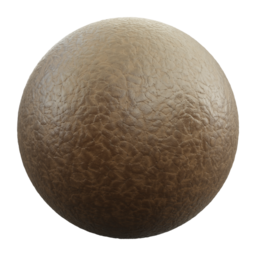</a> <b><a href="Leather001">Leather 001</a></b> by ambientCG · <a href="https://ambientcg.com/a/Leather001">source</a> | <a href="Leather002">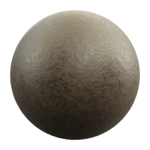</a> <b><a href="Leather002">Leather 002</a></b> by ambientCG · <a href="https://ambientcg.com/a/Leather002">source</a> | <a href="Leather003">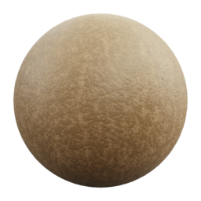</a> <b><a href="Leather003">Leather 003</a></b> by ambientCG · <a href="https://ambientcg.com/a/Leather003">source</a> | <a href="Leather004">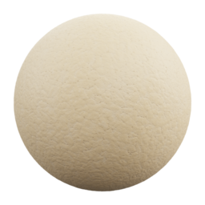</a> <b><a href="Leather004">Leather 004</a></b> by ambientCG · <a href="https://ambientcg.com/a/Leather004">source</a> |
| <a href="Leather005">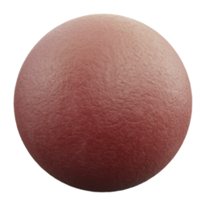</a> <b><a href="Leather005">Leather 005</a></b> by ambientCG · <a href="https://ambientcg.com/a/Leather005">source</a> | <a href="Leather006">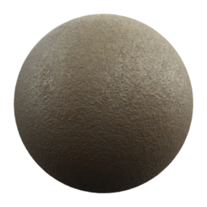</a> <b><a href="Leather006">Leather 006</a></b> by ambientCG · <a href="https://ambientcg.com/a/Leather006">source</a> | <a href="Leather007">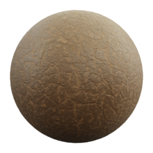</a> <b><a href="Leather007">Leather 007</a></b> by ambientCG · <a href="https://ambientcg.com/a/Leather007">source</a> | <a href="Leather008">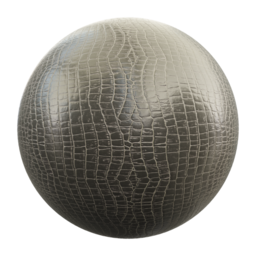</a> <b><a href="Leather008">Leather 008</a></b> by ambientCG · <a href="https://ambientcg.com/a/Leather008">source</a> |
| <a href="Leather009">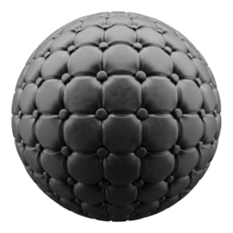</a> <b><a href="Leather009">Leather 009</a></b> by ambientCG · <a href="https://ambientcg.com/a/Leather009">source</a> | <a href="Leather010">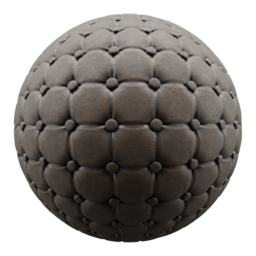</a> <b><a href="Leather010">Leather 010</a></b> by ambientCG · <a href="https://ambientcg.com/a/Leather010">source</a> | <a href="Leather011">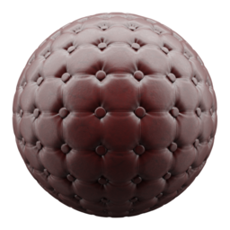</a> <b><a href="Leather011">Leather 011</a></b> by ambientCG · <a href="https://ambientcg.com/a/Leather011">source</a> | <a href="Leather012">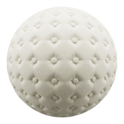</a> <b><a href="Leather012">Leather 012</a></b> by ambientCG · <a href="https://ambientcg.com/a/Leather012">source</a> |
| <a href="Leather013">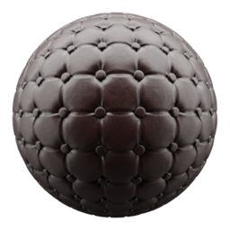</a> <b><a href="Leather013">Leather 013</a></b> by ambientCG · <a href="https://ambientcg.com/a/Leather013">source</a> | <a href="Leather014">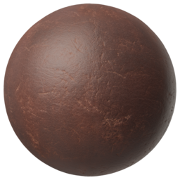</a> <b><a href="Leather014">Leather 014</a></b> by ambientCG · <a href="https://ambientcg.com/a/Leather014">source</a> | <a href="Leather015">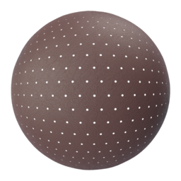</a> <b><a href="Leather015">Leather 015</a></b> by ambientCG · <a href="https://ambientcg.com/a/Leather015">source</a> | <a href="Leather016">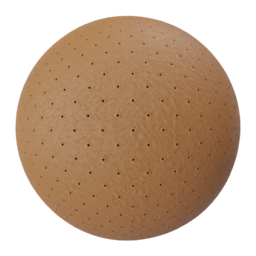</a> <b><a href="Leather016">Leather 016</a></b> by ambientCG · <a href="https://ambientcg.com/a/Leather016">source</a> |
| <a href="Leather017">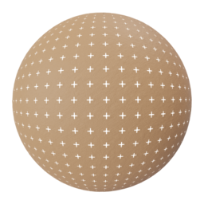</a> <b><a href="Leather017">Leather 017</a></b> by ambientCG · <a href="https://ambientcg.com/a/Leather017">source</a> | <a href="Leather018">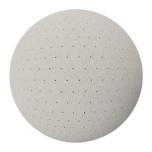</a> <b><a href="Leather018">Leather 018</a></b> by ambientCG · <a href="https://ambientcg.com/a/Leather018">source</a> | <a href="Leather019">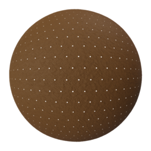</a> <b><a href="Leather019">Leather 019</a></b> by ambientCG · <a href="https://ambientcg.com/a/Leather019">source</a> | <a href="Leather020">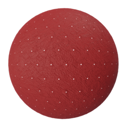</a> <b><a href="Leather020">Leather 020</a></b> by ambientCG · <a href="https://ambientcg.com/a/Leather020">source</a> |
| <a href="Leather021">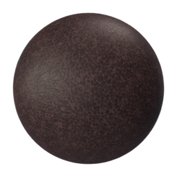</a> <b><a href="Leather021">Leather 021</a></b> by ambientCG · <a href="https://ambientcg.com/a/Leather021">source</a> | <a href="Leather022">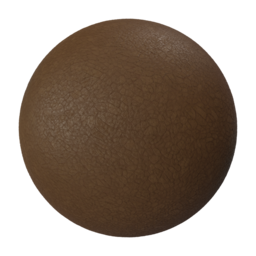</a> <b><a href="Leather022">Leather 022</a></b> by ambientCG · <a href="https://ambientcg.com/a/Leather022">source</a> | <a href="Leather023">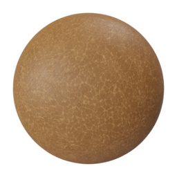</a> <b><a href="Leather023">Leather 023</a></b> by ambientCG · <a href="https://ambientcg.com/a/Leather023">source</a> | <a href="Leather024">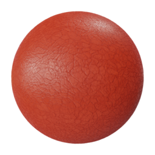</a> <b><a href="Leather024">Leather 024</a></b> by ambientCG · <a href="https://ambientcg.com/a/Leather024">source</a> |
| <a href="Leather025">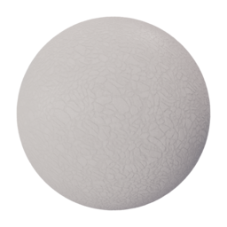</a> <b><a href="Leather025">Leather 025</a></b> by ambientCG · <a href="https://ambientcg.com/a/Leather025">source</a> | <a href="Leather026">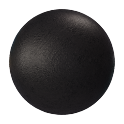</a> <b><a href="Leather026">Leather 026</a></b> by ambientCG · <a href="https://ambientcg.com/a/Leather026">source</a> | <a href="Leather027">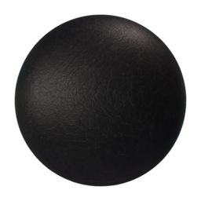</a> <b><a href="Leather027">Leather 027</a></b> by ambientCG · <a href="https://ambientcg.com/a/Leather027">source</a> | <a href="Leather028">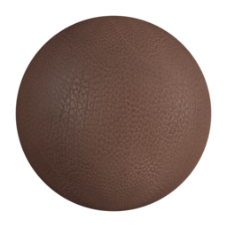</a> <b><a href="Leather028">Leather 028</a></b> by ambientCG · <a href="https://ambientcg.com/a/Leather028">source</a> |

---

Kept up to date by this repository's own [update workflow](.github/workflows/update.yml), with code and plan from [cc0-mirror](https://github.com/zuujis-cc0/cc0-mirror). Something wrong? [Open an issue there](https://github.com/zuujis-cc0/cc0-mirror/issues/new) or use the [private report form](https://games.zuujis.com/report).
